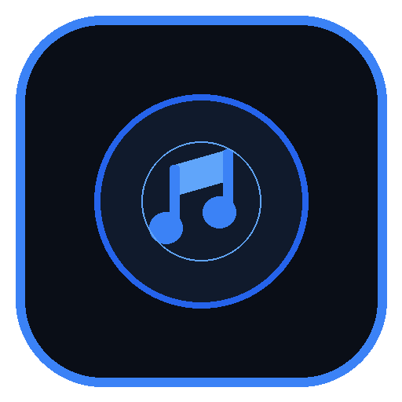
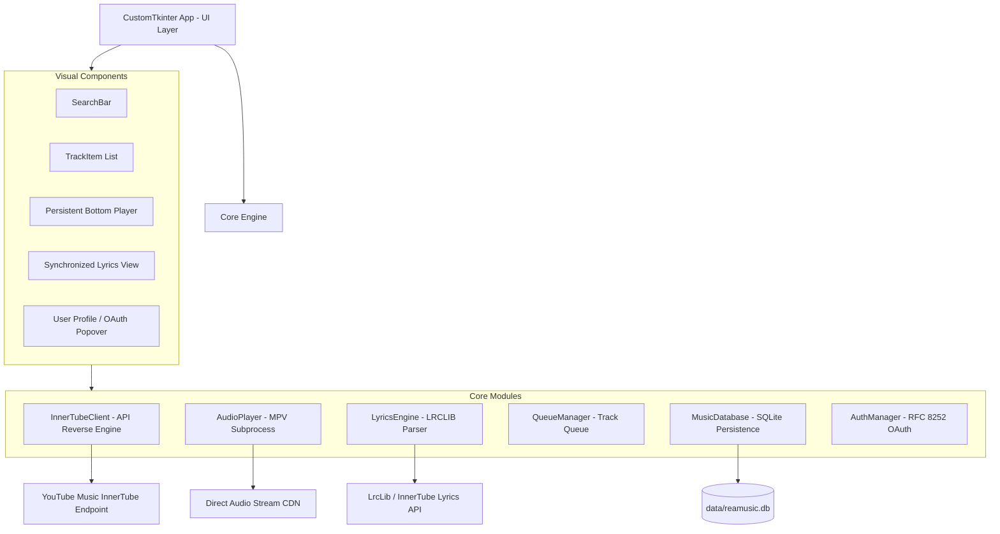

# 🎵 REAMusicApp

<p align="center">
  
</p>

<p align="center">
  <strong>Lightweight, minimalist dark-mode desktop music player powered by asynchronous public stream consumption via YouTube Music InnerTube API reverse engineering and real-time synchronized lyrics.</strong>
</p>

<p align="center">
  <a href="LICENSE"></a>
  
  
  
  
</p>

---

## 📑 Table of Contents

- [Overview](#-overview)
- [Key Features](#-key-features)
- [Software Architecture](#-software-architecture)
- [Directory Structure](#-directory-structure)
- [Prerequisites](#-prerequisites)
- [Local Setup Guide](#-local-setup-guide)
- [Optional Google Sign-In Setup](#-optional-google-sign-in-setup)
- [Building the Standalone Executable (.exe)](#-building-the-standalone-executable-exe)
- [Disclaimer & Legal Notice](#-disclaimer--legal-notice)
- [License](#-license)

---

## 🚀 Overview

**REAMusicApp** is a modern, standalone, high-performance desktop music player. Designed to provide a clean, distraction-free listening experience inspired by Spotify Dark and OpenTune, it directly streams public audio feeds from YouTube Music's CDN without heavy web wrappers or paid subscription barriers.

Engineering highlights:
- **Direct Stream Resolution:** Reverse engineering of the `WEB_REMIX` client from the InnerTube API to resolve raw audio streams (Opus/WebM at ~160kbps).
- **Zero Local Disk Buffering:** Streams directly from Google CDN into an `mpv` player pipeline without intermediate disk writes.
- **Decoupled Asynchronous UI:** Non-blocking interface; search queries, artwork downloading, and stream resolutions execute on background threads guarded by atomic cancellation tokens.
- **Real-Time Synchronized Lyrics:** Full support for timestamped `.lrc` formats with dynamic active-line highlighting and smooth auto-scrolling.

---

## ✨ Key Features

| Feature | Description |
| :--- | :--- |
| 🎧 **Ad-Free Streaming** | Uninterrupted high-fidelity audio playback streamed directly from YouTube Music's public CDN. |
| 🔍 **Instant Search** | Fast lookup for tracks, artists, and albums without requiring API keys or user authentication. |
| 📜 **Synchronized Lyrics** | Embedded LRC parsing engine (LRCLIB + InnerTube fallback) with auto-scroll and click-to-seek. |
| 🔀 **Smart Queue** | Dynamic track queue with continuous playback, next/previous navigation, and repeat controls. |
| 🌙 **Minimalist Dark Mode** | Refined design system utilizing deep `#0f0f0f` obsidian tones with emerald `#1db954` accents. |
| 💾 **SQLite Persistence** | Local library management with dedicated tabs for **Favorites** and **Recent History** (capped at 100 items). |
| 👤 **Optional Google Sign-In** | Standard RFC 8252 OAuth 2.0 loopback login solely for user profile personalization; 100% functional in guest mode. |
| ⚡ **Memory Leak Guard** | Automatic garbage collection and atomic stream token cancellation on track switches. |

---

## 🏗 Software Architecture

The application strictly enforces separation of concerns (SoC), isolating network communication and audio engine operations from UI rendering:



---

## 📁 Directory Structure

```text
reamusic/
├── assets/                 # Visual assets (icon.ico and icon.png in multi-resolution formats)
│   ├── icon.ico
│   └── icon.png
├── core/                   # Core business logic and system services
│   ├── auth.py             # Desktop RFC 8252 OAuth 2.0 flow with local loopback server
│   ├── database.py         # SQLite persistence (Favorites, 100-track History, Playlists)
│   ├── innertube_client.py # InnerTube API client for search and CDN stream extraction
│   ├── lyrics_engine.py    # Synchronized LRC lyrics parser and API resolver
│   ├── player.py           # Real-time mpv subprocess wrapper with timeline sync
│   └── queue_manager.py    # Playback queue manager with auto-advancement
├── data/                   # SQLite database storage directory (ignored in Git)
│   └── .gitkeep
├── ui/                     # Graphical User Interface (CustomTkinter)
│   ├── components/         # Modular reusable components
│   │   ├── bottom_player.py# Persistent bottom bar with playback controls & scrub slider
│   │   ├── lyrics_view.py  # Synchronized lyrics panel with real-time auto-scroll
│   │   ├── search_bar.py   # Debounced search bar with return key listener
│   │   ├── track_item.py   # Track list card with async thumbnail loading
│   │   └── user_profile.py # Login button, credentials dialog, and user profile popover
│   ├── app.py              # Main application window, lifecycle & state orchestration
│   ├── image_cache.py      # Thread-safe in-memory cache for artwork and avatars
│   └── theme.py            # Dark Mode color palette tokens and typography
├── .env.example            # Environment variables configuration template
├── .gitignore              # Strict Git ignore specification
├── build_exe.py            # PyInstaller standalone executable build script
├── LICENSE                 # Official MIT License
├── main.py                 # Application entry point
├── README.md               # Comprehensive project documentation
├── requirements.txt        # Pinned production dependencies
└── test_reverse_engine.py  # CLI verification test suite for search and audio engine
```

---

## 🔧 Prerequisites

1. **Python 3.10 or higher**:
   - Download from [python.org](https://www.python.org/).
2. **Audio Decoding Engine (`mpv`)**:
   - The application leverages the lightweight `mpv` binary to stream and decode audio streams in real time:
     - **Windows**: Download `mpv.exe` from [SourceForge / shinchiro](https://sourceforge.net/projects/mpv-player-windows/files/) and add it to your system `PATH` or place `mpv.exe` in the root directory (also installable via `winget install shinchiro.mpv` or `choco install mpv`).
     - **Linux (Ubuntu/Debian)**: `sudo apt install mpv`
     - **macOS**: `brew install mpv`
   *(Note: If `mpv` is not installed, the application enters an integrated simulation mode protecting the UI from crashes).*

---

## 💻 Local Setup Guide

### 1. Clone the repository
```bash
git clone https://github.com/your-username/reamusic.git
cd reamusic
```

### 2. Create and activate a virtual environment
```bash
# Windows
python -m venv .venv
.venv\Scripts\activate

# Linux / macOS
python3 -m venv .venv
source .venv/bin/activate
```

### 3. Install dependencies
```bash
pip install -r requirements.txt
```

### 4. Run the application
```bash
python main.py
```

---

## 🔑 Optional Google Sign-In Setup

The application is **100% operational in guest mode without logging in**. However, if you wish to display your Google account name and avatar:

1. Navigate to the [Google Cloud Console](https://console.cloud.google.com/apis/credentials).
2. Create a new project and open **Credentials** > **Create Credentials** > **OAuth client ID**.
3. Set the application type to **Desktop app**.
4. Copy the generated `Client ID` and `Client Secret`.
5. Create your `.env` configuration file from the template:
   ```bash
   cp .env.example .env
   ```
6. Paste your credentials into `.env`, or enter them directly inside the app by clicking **Sign in with Google** > **Configure Credentials**.

---

## 📦 Building the Standalone Executable (.exe)

The repository provides an automated build script using PyInstaller that bundles all assets, themes, and icons into a windowed executable with no console window (`--noconsole`):

```bash
python build_exe.py
```

The resulting standalone executable will be generated at:
```text
dist/REAMusic.exe
```

*(Tip: If `mpv.exe` is present in the workspace root during build, the builder will automatically bundle it into the final package).*

---

## ⚖️ Disclaimer & Legal Notice

> [!IMPORTANT]
> This project was developed **strictly for educational, software architecture research, and protocol reverse engineering purposes**.
> 
> - **REAMusicApp** is not affiliated with, authorized, maintained, or endorsed by Google LLC or YouTube.
> - The software does not download, store permanently, or distribute copyrighted media; it only decodes public network streams on-demand.
> - Use of this software must comply with applicable local copyright laws and third-party Terms of Service. Developers and contributors assume no liability for misuse.

---

## 📄 License

This project is licensed under the terms of the **MIT License**. See the [LICENSE](LICENSE) file for details.
